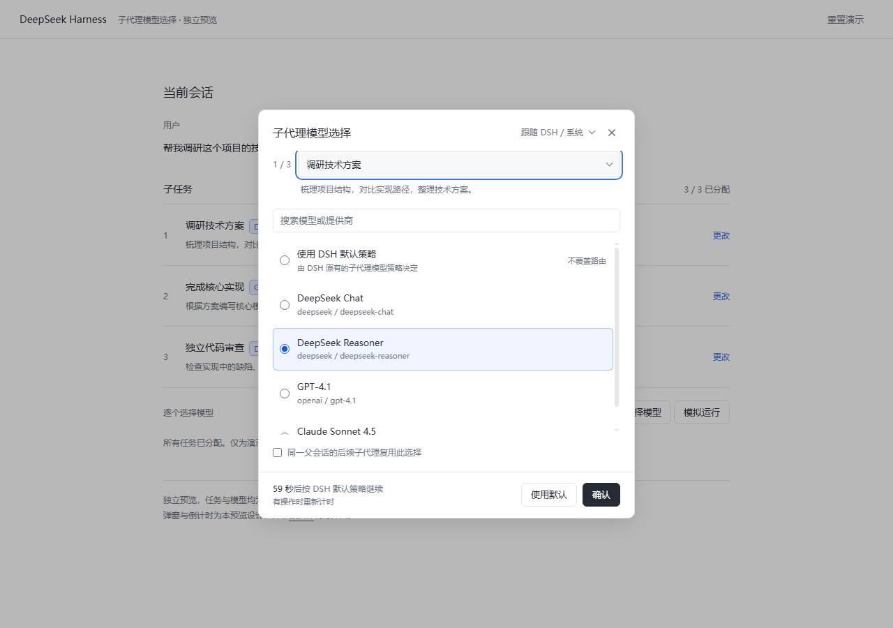
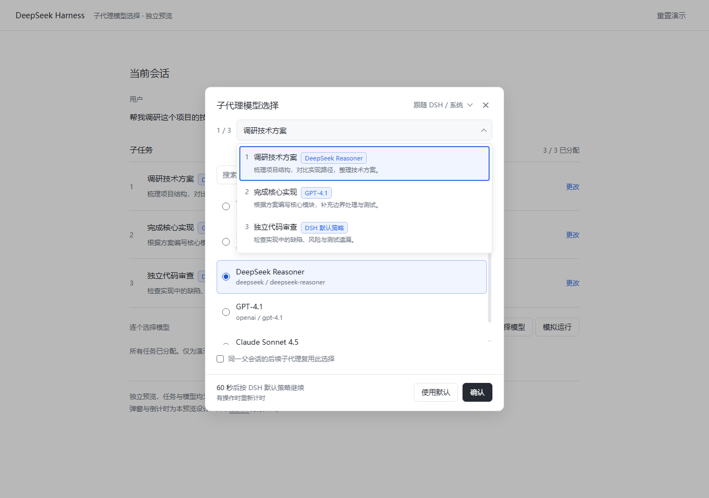
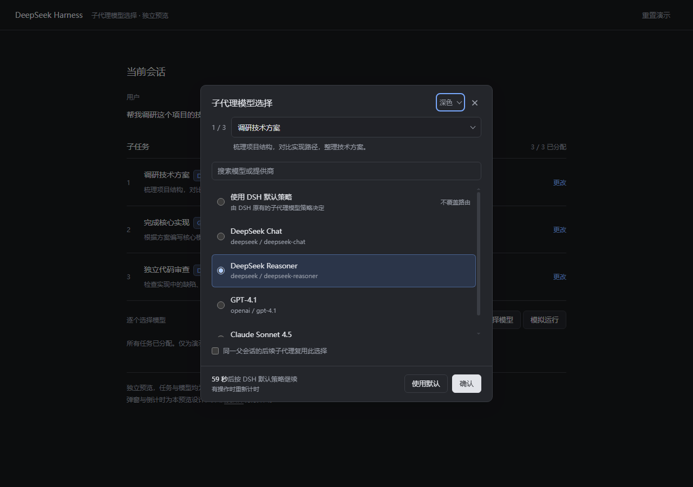
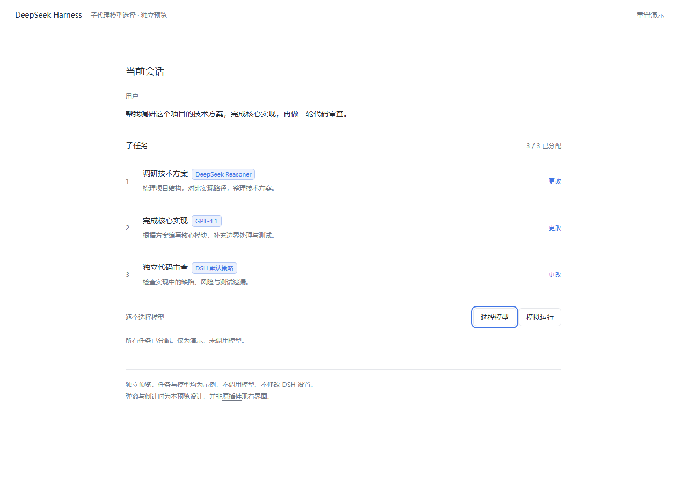

# dsh-selective-subagent

给 **DeepSeek Harness (DSH)** 的子代理加一层"人来选模型"的环节：AI 拆分任务、准备派子代理时，先弹窗让你为该任务指定 provider / 模型；60 秒无操作则保持 DSH 原本的子代理路由继续。

> 这不是独立网页，也不是第三方 Desktop 插件的安装脚本。本项目是标准 DSH bundle，只使用当前版本公开的 `agent/created`、`agent.model.select()` 与 Connection RPC 接口。

## 功能

- **逐任务选择模型**：子代理创建时等待你的回答，回答前不会发起第一次模型请求。
- **任务栏与序号**：`1 / 3` 在行首，长条下拉切换待选任务；任务名后以蓝色圆角标签显示已确认的模型。
- **真实模型目录**：从已配置的 LLM Provider 读取，支持搜索与滚轮滚动。
- **DSH 默认策略**：选择它表示**完全不覆盖**原路由，而不是强制跟随父级模型；60 秒无操作时同样走这条路径。
- **复用选择**：可把某次具体模型选择应用到同一父会话后续子代理；"默认策略"不会建立复用。
- **跟随主题**：使用 DSH 主题 token，支持明暗主题；字体优先微软雅黑。
- **动效克制**：下拉逐项展开、选中圆角底色 180ms 淡入淡出，遵循系统的减少动态效果偏好。

## 预览

> 以下为交互设计预览（在独立预览页面中渲染），**不是安装后的运行截图**；实际外观以插件安装后的 DSH 界面为准。





| 深色主题 | 任务栏模型标签 |
| --- | --- |
|  |  |

## 环境要求

- 依据 DSH `0.2.2-rc.1` 的公开契约编写；接口签名随版本变化的可能始终存在。
- 无第三方运行时依赖，不需要构建工具链（`client.js` 已随仓库提供）。

## 安装

只能用官方插件入口安装。**不要**手工改写 profile 的 `package.json` / `cordis.patch.yml`，也不要执行旧版第三方插件那种 junction 安装脚本。

- **Agent / 工具**：`plugin_manager` 的 `install_bundle`，`target` 指向本仓库目录或对应的 tarball。
- **Web GUI**：侧栏 **Plugins / 插件** 页面添加本地包。
- **CLI**：`dsh plugin --profile <profile> add <本目录或 tarball>`。

安装会占用 profile 的写入锁 `<profile>/package.json.lock`。若报 `atomic-write: timed out waiting for the writer lock`，说明另有插件安装/更新正在持有该锁：等它结束，必要时重启 DSH 释放锁，再重试；**不要删除仍由活进程持有的锁文件**。

安装后核验：

1. `Config.listConfigs` 出现 bundle `dsh-selective-subagent`；
2. Client `Slots.listSubTree` 的 `shell.overlay` 与 `conversation.composer.dock` 出现本插件条目；
3. 新建一个会派子代理的任务，弹窗出现且子代理在回答前不发起模型请求。

## 使用

1. 发起一个需要创建子代理的任务。
2. 弹窗中为当前任务选择模型，或选择"使用 DSH 默认策略"。
3. 勾选复用后，具体模型会应用于同一父会话尚待选择的任务和后续同级子代理。
4. 连续 60 秒无操作，Host 按各任务原有 DSH 路由继续。弹窗内的鼠标、键盘、输入、滚轮操作会续期同一根会话的全部待选任务。
5. 输入框下方的插件任务栏可查看实际生效的模型标签，或重新打开收起的选择弹窗。

已经开始运行的子代理不会中途换模型。

## 配置

bundle 默认配置：

```yaml
config:
  enabled: true          # 总开关
  idleMs: 60000          # 无操作回退毫秒数（1000–3600000）
  askOncePerParent: false # 默认不自动复用；弹窗内可显式复用
```

## 实现概要

- **Host**：`host/index.js` + `host/engine.js`
  - 在 `agent/created`（serial，AgentLoop 会在所有监听器结束后才处理排队输入）中等待用户。
  - 具体选择通过公开的 `agent.model.select()` 提交，写入标准 `model/selection`，保证会话头与实际请求路由一致。
  - 不监听已移除的 `agent/request`，不在 `llm/stream` 中私自换模型，不注册 Tool/命令。
  - 默认与超时路径完全不调用 `select`，原路由原样保留。
- **Client**：`client-source.js` + `ui.css` → 由 `build.mjs` 打包成 DSH ModuleLoader 使用的 `client.js`。
  - 两个扩展位：`shell.overlay`（选择弹窗）、`conversation.composer.dock`（插件任务栏）。
- **通信**：Connection 通用 RPC，`/api` 通道下三个端点：

  | 端点 | 作用 |
  |---|---|
  | `selective-subagent/state` | 读取快照；`afterRevision` + `waitMs` 长轮询（≤25s） |
  | `selective-subagent/activity` | 续期同一根会话的全部待选任务 |
  | `selective-subagent/choose` | 提交具体模型，或 `route: null` 表示 DSH 默认策略 |

  快照包含稳定 `instanceId`、`revision`、`serverNow`、`timeoutMs`、模型目录与任务状态。
- **权限**：选择与续期只接受 `principal.kind === 'owner'` 且 `interactions === 'answer'` 的已认证 Peer；插件不注册任何能替用户确认的 Agent Tool。

## 已知限制

- 只覆盖本进程创建的子代理（`spawn` / `fork` 等 in-process provider）。ACP、Claude Code、Codex 等外部子进程执行器不受控。
- 正在运行的子代理不会因首次安装而被重新询问；选择只发生在安装后新建的子代理上。
- 已完成任务为当前 Host 进程内的有界缓存（最多 200 条已完成/取消），模型选择本身仍记录在 DSH 标准会话日志。
- 弹窗按页面会话显示对应根会话的任务；切换会话或收起弹窗不会暂停 Host 的 60 秒超时。
- 模型目录取决于你的 Provider 配置；插件不创建凭据、不新增模型、不修改允许模型列表。

## 开发

```powershell
node build.mjs            # 从 client-source.js + ui.css 生成 client.js
node --test test/*.mjs    # Host 与 Client 逻辑测试（30 项）
```

`client.js` 是构建产物且随仓库提交，安装时无需构建。修改 `client-source.js` / `ui.css` 后必须重新构建，CI 会校验构建产物与源码一致。

## 状态

- 源码层：Host 20 项 + Client 10 项逻辑测试通过（`node --test`）。
- 运行层：**尚未**在安装后的真实 DSH 界面与真实子代理流程中验证；首次安装受 profile 写锁阻塞，未完成。

## 许可证

MIT，见 [LICENSE](LICENSE)。

---

## English

Pick a model for each DSH subagent before it starts. A modal waits for the user at `agent/created`, commits the choice through the public `agent.model.select()`, and falls back to the untouched DSH route after 60 idle seconds. Blue rounded model badges appear in the plugin's own task bar and task dropdown. In-process subagents only; no third-party runtime dependencies.
